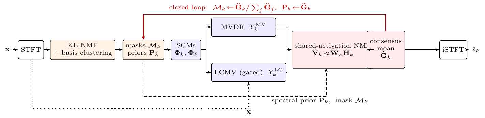
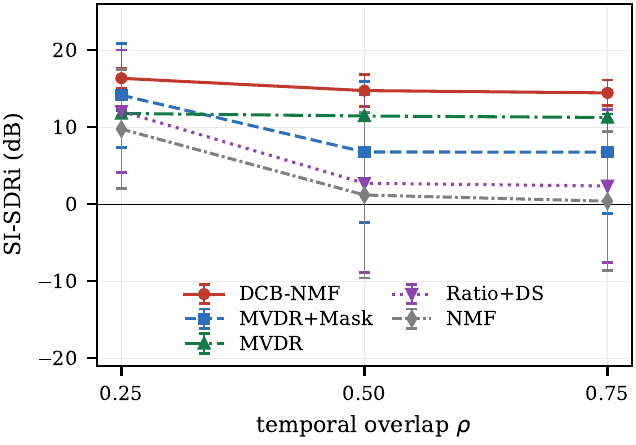
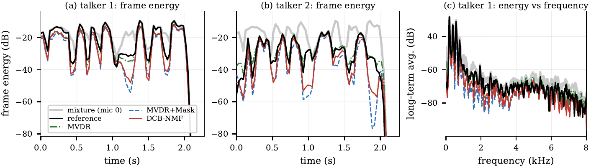

# DCB-NMF: Closing the Loop Between Beamforming and NMF for Speech Separation

Official code, data manifest and raw results for

> T. A. Le, M. D. Ha, V. V. Le, D. P. Nguyen, T. T. Quan, "DCB-NMF: Closing the Loop
> Between Beamforming and NMF for Speech Separation," in *Proc. RIVF International
> Conference on Computing and Communication Technologies (RIVF)*, 2026.

## Overview

Mask-informed beamforming uses a time-frequency mask to estimate spatial covariance
matrices (SCMs) for an MVDR filter, but in the standard pipeline the mask is never
updated from the beamformer output: errors in the initial mask propagate to every
later stage, and the multiplicative mask postfilter removes any bin that either
factor suppresses.

**DCB-NMF** closes this loop. For each source it collects several nonnegative
*views* — the MVDR output, a single-channel NMF spectral prior, the masked MVDR
output and an optional LCMV output with nulls toward competing talkers — and
factorizes them jointly with **shared activations**. The estimate is read from a
**consensus subset** of the per-view reconstructions, then renormalized into masks
that re-enter SCM estimation in the next outer iteration. The method is
training-free and runs at a real-time factor of about 0.4 in plain NumPy.



*Fig. 1. Orange: spectral masks and priors; blue: beamformer outputs; red:
shared-activation NMF fusion with consensus readout. The red feedback path
updates the masks for the next outer iteration.*

The four stages:
1. **NMF initialization** – KL-NMF on the reference-microphone magnitude; bases are
   grouped by spherical k-means on the spectral templates, giving per-source priors
   and Wiener masks (assigned to sources by IPD agreement when DOAs are known).
2. **Parallel spatial filters** – manifold-steered MVDR and a geometry-gated LCMV,
   both from mask-weighted SCMs with diagonal loading.
3. **Shared-activation fusion** – the views are stacked and factorized with one
   activation matrix; the output is the mean of the consensus subset
   C = {MVDR, prior, masked MVDR}, blended with the masked MVDR by α.
4. **Closed-loop update** – the fused magnitudes become the masks and priors of the
   next outer iteration.

## Results

### Synthetic controlled grid (45 test mixtures, 4-mic ULA, 10 dB diffuse noise)

Hyperparameters (readout, α = 0.4) selected on a disjoint 27-mixture development
grid. Mean SI-SDRi (dB) per temporal-overlap ratio ρ, averaged over Δθ ∈ {90°, 120°, 150°}:

| Method | ρ = 0.25 | ρ = 0.50 | ρ = 0.75 | All (mean ± std) |
|---|---|---|---|---|
| MVDR | 11.78 | 11.46 | 11.27 | 11.50 ± 0.5 |
| MVDR+Mask | 14.15 | 6.78 | 6.77 | 9.23 ± 8.8 |
| **DCB-NMF** | **16.35** | **14.75** | **14.45** | **15.19 ± 1.9** |

DCB-NMF ranks first in all nine (Δθ × ρ) cells (Table I of the paper):
+5.95 dB over MVDR+Mask (Wilcoxon p = 2.1×10⁻⁷) and +3.68 dB over MVDR
(p = 5.7×10⁻¹⁴).



*Fig. 2. SI-SDRi against temporal overlap (mean ± 1 std over 15 mixtures per ρ).
MVDR+Mask degrades with overlap; DCB-NMF does not.*

**Ablation (Table II).** Removing the closed loop costs 2.89 dB (4.00 dB at ρ = 0.75).
Feedback alone lifts MVDR+Mask from 9.23 to 13.57 dB (iterative MVDR-mask, α = 0,
same L = 2); feeding back the fused estimate adds a further 1.62 dB and halves the
spread (std 3.74 → 1.89 dB). Per-view instead of shared activations: −0.06 dB;
geometric readout: −0.81 dB; LCMV inside the consensus subset: −3.89 dB.

### Reverberant LRS2-2mix spatializations (100 speech pairs × 5 angle configurations, 2 mics)

Mean SI-SDRi (dB), known DOAs (Table III):

| Method | 150° | 120° | 90° | 60° | 30° | All |
|---|---|---|---|---|---|---|
| NMF | −2.41 | −3.54 | −1.58 | −3.40 | −3.63 | −2.91 ± 2.8 |
| MWF | −0.41 | −1.59 | 0.31 | −1.55 | −1.61 | −0.97 ± 2.7 |
| MVDR | 6.65 | 4.01 | −1.50 | 2.35 | −1.89 | 1.92 ± 3.9 |
| MVDR+Mask | −0.41 | −1.84 | −4.36 | −2.62 | −4.56 | −2.76 ± 3.3 |
| Ratio+DS | −2.78 | −3.62 | −2.70 | −3.45 | −2.94 | −3.10 ± 2.8 |
| **DCB-NMF** | 5.12 | 2.84 | −2.73 | 0.73 | −3.60 | 0.47 ± 4.2 |

Over the 100 speech pairs, DCB-NMF leads MVDR+Mask by 3.23 dB (95% CI [3.08, 3.38],
better on all 100 pairs) and trails plain MVDR by 1.45 dB (CI [−1.61, −1.31]).
Aggregated over all 500 mixtures, fusion recovers 2.9 dB (weak-target frames) and
5.2 dB (target-dominant frames) of the energy that the multiplicative postfilter removes.



*Fig. 3. Frame energy of the best-scoring LRS2-2mix mixture (Δθ = 120°, DCB-NMF
10.79 dB SI-SDRi): deliberately selected as the best case, not representative of the
average.*

**STFT overlap (Table IV).** Doubling the hop (75% → 50% overlap, α retuned) changes
no method by more than 0.33 dB.

## Repository layout

```
dcb_nmf/                 the method and all baselines (library)
experiments/synthetic/   synthetic controlled grid
experiments/lrs2/        LRS2-2mix spatial benchmark
results/                 raw per-mixture results behind every number in the paper
data/lrs2_2mix_spatial/  LRS2-2mix spatial subset: metadata and manifests (see data/README.md)
figures/                 Figs. 1-3 of the paper (PDF and PNG)
```


## Running the experiments

```bash
pip install -r requirements.txt

# synthetic grid (~40 min on one CPU core); mixtures are generated from fixed seeds
python experiments/synthetic/eval_paper.py     # baselines + alpha sweep  -> results/synthetic/paper_raw.json
python experiments/synthetic/dev_select.py     # readout / alpha choice   -> results/synthetic/dev_raw.json
python experiments/synthetic/test_final.py     # final config + ablations -> results/synthetic/test_final.json

# LRS2-2mix spatial (needs the audio in data/lrs2_2mix_spatial, see data/README.md)
python experiments/lrs2/eval_hn.py             # Table III -> results/lrs2/
python experiments/lrs2/eval_stft_overlap.py   # Table IV  -> results/lrs2_overlap/
python experiments/lrs2/energy_aggregate.py    # energy    -> results/energy/ (resumable)
```
The scripts overwrite the stored results; re-running them reproduces the stored
per-mixture SI-SDRi to within 10⁻³ dB (verified with Python 3.10, NumPy 2.2,
SciPy 1.15; original runs with Python 3.13 on Windows).

### Configurations used in the paper

| | synthetic grid | LRS2-2mix spatial |
|---|---|---|
| array | 4-mic ULA, 5 cm | 2 mics, 4.57 cm |
| STFT | 1024 Hann, hop 256 (75%) | 1024 Hann, hop 256 (75%); hop 512 in Table IV |
| NMF bases K / fusion rank B | 16 / 10 | 16 / 10 |
| multiplicative updates (Stage 1 / fusion) | 60 / 40 | 80 / 60 |
| outer iterations L | 2 | 3 |
| consensus readout | arithmetic (dev-selected) | geometric (implementation default) |
| blend α | 0.4 (development grid) | 0.4 (10-file tune subset, held in) |
| LCMV branch | factorized, excluded from consensus | inactive (M = 2 leaves no null) |
| diagonal loading λ / LCMV gate τ | 0.02 / 0.92 | 0.02 / 0.92 |
| DOAs | known | known |

## Citation

```bibtex
@inproceedings{le2026dcbnmf,
  author    = {Le, Tuan Anh and Ha, Manh Dung and Le, Van Viet and Nguyen, Duy Phuong and Quan, Trong The},
  title     = {{DCB-NMF}: Closing the Loop Between Beamforming and {NMF} for Speech Separation},
  booktitle = {Proc. RIVF International Conference on Computing and Communication Technologies (RIVF)},
  year      = {2026}
}
```

## License

The code, results and figures in this repository are released under the
[MIT License](LICENSE). The LRS2-derived audio is not included and remains subject
to the LRS2 dataset licence (see [data/README.md](data/README.md)).

